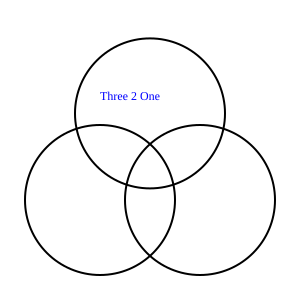

# README

Developed by Three 2 One @ SliverFocs.

## Feature

### Coding

- Module `For` for future developing.
- Good Model organization

### Viewing

- Beautiful drawings.

## About us

Our Name: Three 2 One.



From:

Unfortunately, one of our group members have not registered gitea and we could not find this group member by canvas or other communication tools. So we have to complete our project by three person.
However, we believe that we can make our project wonderful .
So we name us Three (person) 2 (To) One (wonderful project).

## Rule for Work

This file is used to rule our cooperation on project 1.

Workflow:
```
change branch <------------> check branch -------------> master branch -------------> release
                 merge to  (after checking)  merge to                      release
```
Commit format:

```
p${project_id}m${milestone_id}_${one's action}
```

Example:

```
p1m1_initModel
```
